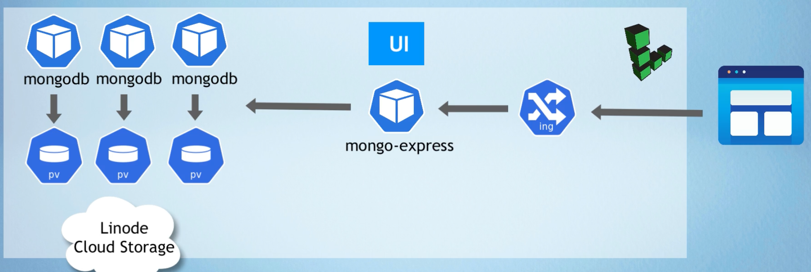
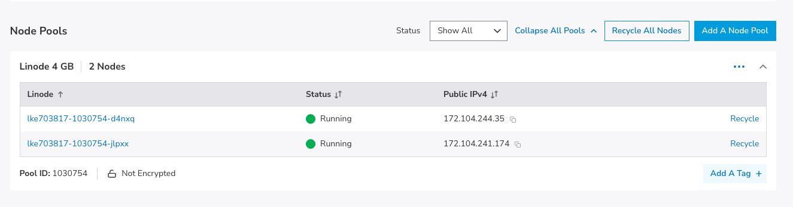
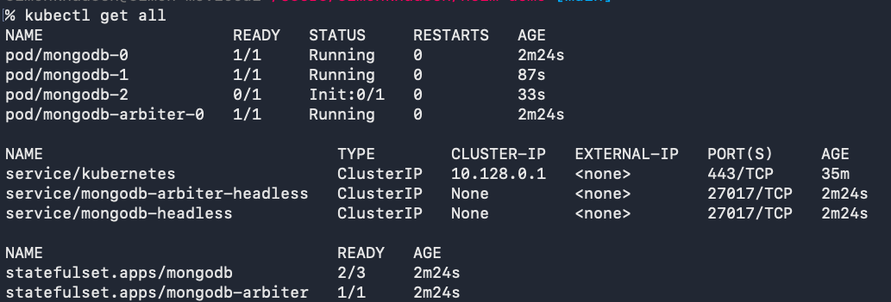
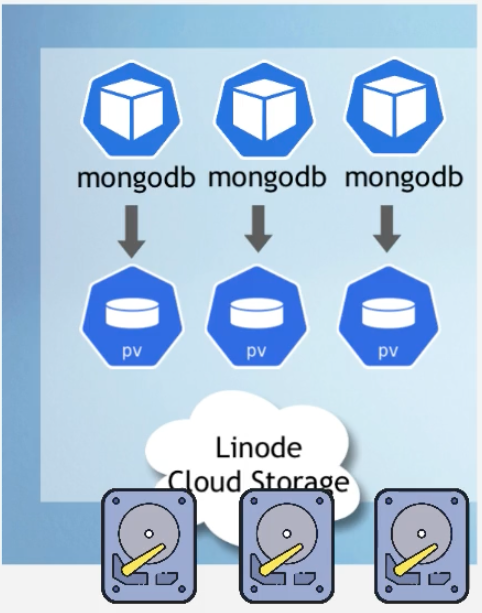
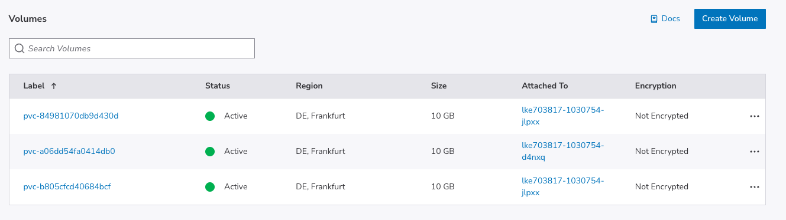
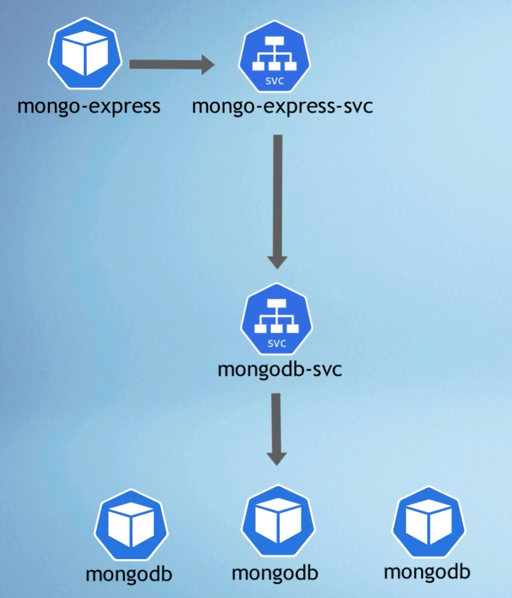
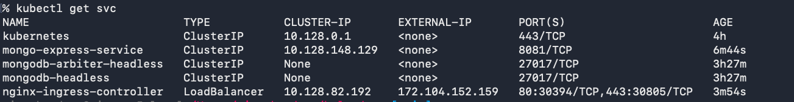
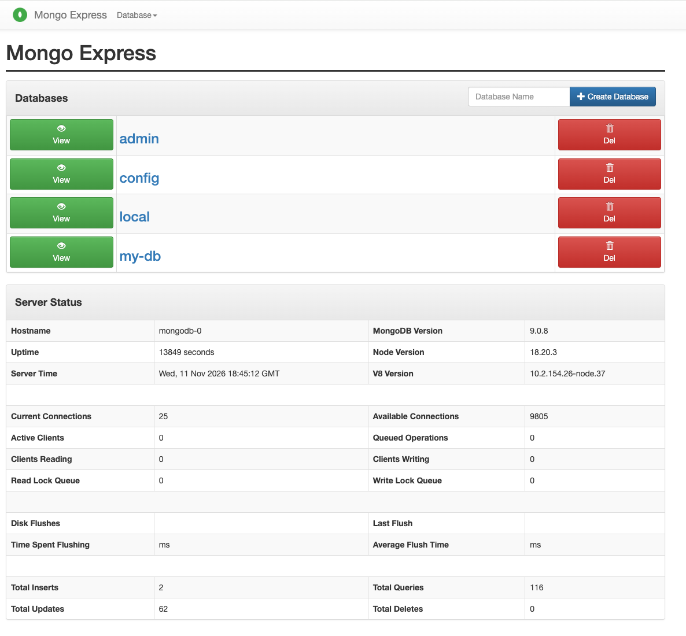

# Installing a stateful service (MongoDB) on Kubernetes using Helm

 

**Technologies used:** Kubernetes, Helm, MongoDB, Mongo Express, Linode LKE, Linux

 

In this project I deployed a replicated MongoDB database on a managed Kubernetes cluster in Linode (LKE) using a Helm chart. The data is stored on Linode cloud storage, so it stays even if a pod is restarted or moved. I then deployed Mongo Express as a web UI for the database and made it available in the browser through an NGINX ingress.

 

_Architecture: browser → NGINX ingress → Mongo Express → MongoDB replica set, with each MongoDB pod backed by a persistent volume on Linode cloud storage._

 

## 1. Create a managed Kubernetes cluster on Linode

I created a Kubernetes cluster with Linode Kubernetes Engine (LKE) in the Frankfurt region, with a node pool of two 4 GB worker nodes. Linode manages the control plane, so I only had to download the kubeconfig file and point `kubectl` to it.

 

_The LKE node pool with two running worker nodes._

 

## 2. Deploy replicated MongoDB with Helm

Instead of writing all the StatefulSet, Service and Secret files myself, I used the Bitnami MongoDB Helm chart and overrode its defaults with my own values file, [helm-mongodb.yaml](helm-mongodb.yaml). It runs MongoDB as a replica set of three pods plus an arbiter, and stores the data on Linode block storage.

 

_The MongoDB StatefulSet starting up: the pods are created one at a time (mongodb-0, -1, -2), together with the arbiter and the headless services._

 

## 3. Configure data persistence with Linode cloud storage

Because the values file uses the `linode-block-storage` storage class, every MongoDB pod gets its own Persistent Volume Claim. Linode automatically creates a block storage volume for each claim and attaches it to the node where the pod runs. If a pod dies, the new pod mounts the same volume and the data is still there.

 

_Each MongoDB pod has its own persistent volume, stored on Linode cloud storage._

 

_The three 10 GB volumes created automatically in Linode and attached to the worker nodes._

 

## 4. Deploy Mongo Express

Mongo Express is a web UI for managing MongoDB. I deployed it with my own Deployment and Service in [helm-mongo-express.yaml](helm-mongo-express.yaml). It reads the root password from the `mongodb` secret that the Helm chart created, and connects to the database through the headless service at `mongodb-0.mongodb-headless:27017`. The service `mongo-express-service` is internal (ClusterIP) on port 8081.

 

_Mongo Express talks to its own service, which forwards to the MongoDB service and the MongoDB pods behind it._

 

## 5. Deploy and configure the NGINX ingress

To reach Mongo Express from a browser, I installed the NGINX ingress controller with Helm. This also created a Linode NodeBalancer, which gives the cluster one public IP address.

 

_All pods running: three MongoDB pods, the arbiter, Mongo Express and the NGINX ingress controller._

 

_The ingress controller service is of type LoadBalancer and has a public external IP from Linode._

 

I then created an Ingress rule in [helm-ingress.yaml](helm-ingress.yaml) that sends all traffic for the NodeBalancer's host name to `mongo-express-service` on port 8081.

 

## Result

Opening the host name in the browser shows the Mongo Express UI. It is connected to the MongoDB replica set, and I can create databases and collections. Because the data is on Linode volumes, it stays even when the MongoDB pods are restarted.

 

_Mongo Express in the browser through the ingress, connected to MongoDB (hostname mongodb-0) with a test database `my-db`._

 
